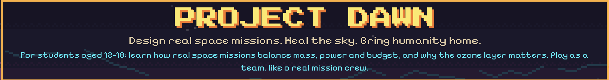
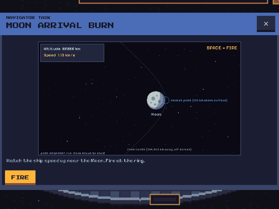
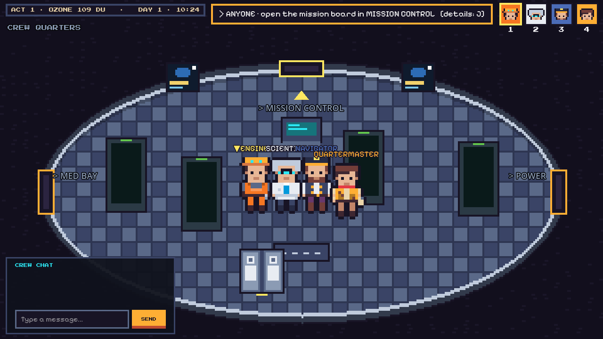
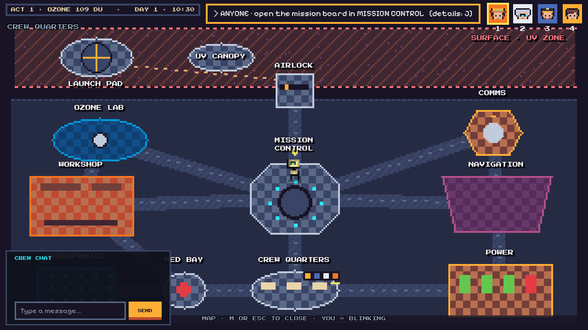
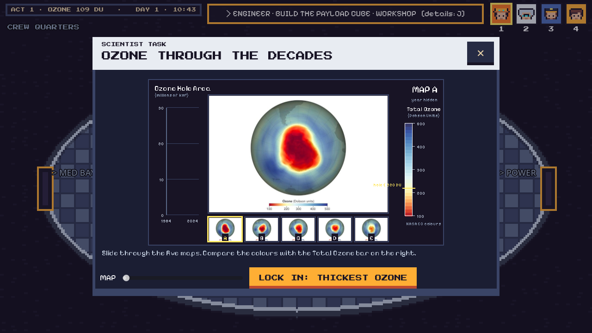
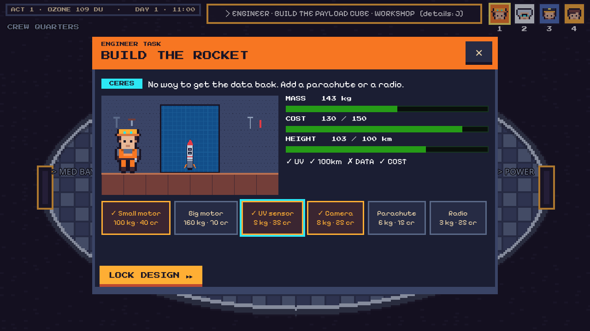
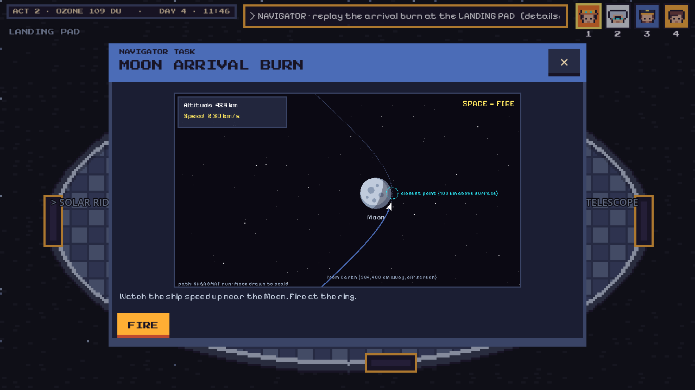
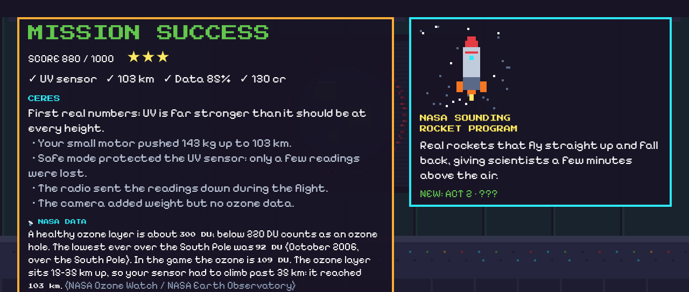
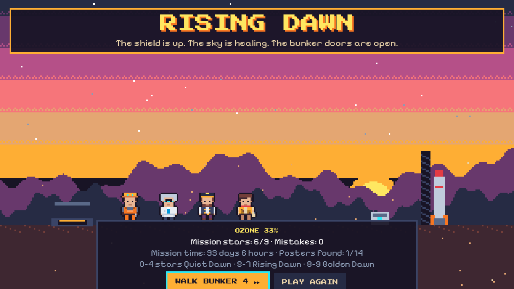

<p align="center">
  
</p>

<p align="center">
  <a href="https://34-50-21-254.sslip.io"></a>
  <a href="https://youtu.be/XyVfqFLEl7w"></a>
  <br>
  
  
  
  
</p>

> **The sky is broken.** A dying star far away exploded in a gamma-ray burst and tore Earth's ozone layer apart.
> Everyone lives underground now. You have a crew of four, a bunker full of spare parts, a very chatty AI
> named CERES, and one job: **fix the sky.**

**Project Dawn** is a co-op pixel-art game where you and up to three friends run a real space mission,
from a tiny sounding rocket on Earth all the way to a UV shield parked between the Sun and Earth.
Every minigame runs on real NASA data. When your mission fails (and it will, at least once), the game
tells you exactly *why*, with the real numbers.

### ▶ [Play it now at 34-50-21-254.sslip.io](https://34-50-21-254.sslip.io), no download needed

Desktop browser, sound on, press **PLAY SOLO**. Got friends nearby? One of you picks **HOST A CREW**
and shares the room code, everyone else picks **JOIN A CREW**.

<p align="center">
  
</p>

---

## 🎬 Watch it first

<p align="center">
  <a href="https://youtu.be/XyVfqFLEl7w"></a>
  <br><sub>Click to watch on YouTube</sub>
</p>

---

## Meet your crew

You play one of four roles. The same four jobs exist on every real NASA mission.

| | Role | What they do in the game | Real mission job |
|---|---|---|---|
| 🔧 | **Engineer** | Builds the rocket, tightens the bolts, opens the shield | Space segment: the spacecraft |
| 🔬 | **Scientist** | Reads ozone maps, finds ice in spectra, scans sunlight | User segment: the science |
| 🧭 | **Navigator** | Reaches orbit, nails the Moon arrival burn, holds the shield at L1 | Launch segment: getting there |
| 📦 | **Quartermaster** | Picks instruments, packs cargo, keeps the data flowing home | Ground segment: resources and comms |

Playing alone? Press **TAB** to jump between them, or let **CERES autopilot** walk the others around.
The big moments (readiness review, boarding, launch) need all four crew on their spots at once,
just like a real launch team.

---

## The mission

| | Act | Where | What happens |
|---|---|---|---|
| 🌍 | **1 · First Light** | Bunker 4, Earth | Build a sounding rocket, launch it into the UV and find out how bad things really are |
| 🌕 | **2 · Water Above Us** | Moon, south pole | Hunt for ice in craters the Sun never touches, turn it into rocket fuel, survive a solar storm |
| ☀️ | **3 · The Shield** | Moon → L1 → home | Build a UV shield, fly it 1.5 million km to L1, then head home for the first real sunrise |

How well your crew does decides the ending: **Quiet Dawn**, **Rising Dawn** or **Golden Dawn**.
No bad endings. We think humanity deserves one.

| | |
|---|---|
|  |  |
|  |  |
|  |  |

<p align="center"></p>

---

## A minigame at every station, all real science

| | 🔧 Engineer | 🔬 Scientist | 🧭 Navigator | 📦 Quartermaster |
|---|---|---|---|---|
| **Act 1** | Build a CubeSat from the real CSA paper model · design the rocket · pre-flight bolts | Compare NASA ozone maps from 1984 to 2024 · pick the landing site | Pick a calm launch hour · Newton's cannon: find orbit speed | Pick rocket instruments by real mass, power and data · pack the shuttle |
| **Act 2** | Scan for ice with LRO's Diviner and LEND | Find water's fingerprint in the LCROSS spectrum | Fire the Moon arrival burn on a NASA GMAT path · split ice into fuel | Pack the outpost instruments · power the outpost · wire the cable |
| **Act 3** | Design the shield · open its aperture without jamming (like Hubble) | Sort sunlight: what does ozone stop? | Keep the shield balanced at L1 with 10 taps of fuel | Send the data home before the signal fades |

### Things you'll learn without noticing

- Why going sideways fast enough means you **fall around the Earth** instead of into it (about 7.7 km/s)
- Why ice survives at the Moon's poles: Cabeus crater sits around **37 K** (about −236 °C)
- Why the 1994 ozone hole hit a record low of **73 Dobson units**, and why it's slowly healing
- Why every extra kilogram on a rocket costs you fuel, power and money

---

## For the judges

**See the whole game in about 10 minutes:**

1. Open **[34-50-21-254.sslip.io](https://34-50-21-254.sslip.io)** in a desktop browser and press **PLAY SOLO**.
2. Pick any role and choose **CERES AUTOPILOT**, so the other three crew walk to their spots by themselves.
3. Follow the yellow bar at the top of the screen. Press **TAB** to switch to the role it asks for.
4. Short on time? Press **F8** (or Esc → Settings → Review mode). Every minigame then finishes in one
   click, so you can see all three acts, the reports and the ending. Press F8 again to play one for real.

**Worth a look:**

- **The mission reports** after the rocket launch and the shield. They explain *why* the mission worked
  or failed, with the numbers, and name the real NASA mission behind it.
- **The "NASA data" line** at the end of every minigame, with where the numbers come from.
- **The readiness review**, where all four roles have to agree before launch.

**Where things are:**

| Looking for | File |
|---|---|
| The story, step by step | [`docs/STORY_MOON_ONLY.md`](docs/STORY_MOON_ONLY.md) |
| Every NASA source with links | [`docs/SOURCES.md`](docs/SOURCES.md) |
| The science behind the L1 shield | [`docs/L1_SHIELD_SCIENCE.md`](docs/L1_SHIELD_SCIENCE.md) |
| Our data and image pack | [`data_management/`](data_management) |
| The original longer design (with Mars) | [`docs/STORY.md`](docs/STORY.md) |
| Credits for images, fonts and sounds | [`assets/CREDITS.md`](assets/CREDITS.md) |
| How the code is organised | [`docs/CODE_MAP.md`](docs/CODE_MAP.md) |

**What's real and what isn't:** costs, limits and scores are simplified game values unless
[`docs/SOURCES.md`](docs/SOURCES.md) gives a real reference. The UV shield at L1 is game fiction,
inspired by real proposals for space sunshades. The rest is real science and real NASA missions.

---

## NASA data inside the game

| In the game | Where it comes from |
|---|---|
| Ozone maps and hole sizes, 1984–2024 | NASA Earth Observatory (World of Change), NASA Ozone Watch |
| Instruments: OMI, MARCI, CRaTER, LEND, LAMP, LOLA, LROC, Diviner, HiRISE, SAM, TEGA | NASA instrument fact sheets (our `instruments.csv`) |
| The flight path around the Moon | A NASA GMAT run (General Mission Analysis Tool) |
| Ice at the lunar south pole | LRO Diviner and LEND, LCROSS (Colaprete et al. 2010), M3 |
| Orbit speed | NASA Earth Fact Sheet |
| L1 and station-keeping | NASA Lagrange point pages, SOHO, DSCOVR |
| Data rates | NASA Deep Space Network |

---

## Controls

| Key | Action |
|---|---|
| **W A S D** / arrows | Walk |
| **E** / Enter | Use a console, talk |
| **Space** / click | Next line of dialogue |
| **TAB** · **F** · **C** | Switch crew member · crew follows you · CERES autopilot |
| **M** · **J** | Bunker map · mission details |
| **T** | Show / hide the crew chat |
| **Esc** | Menu, or close a window |
| **F8** | Review mode (one-click minigames) |

---

## Run it yourself

1. Install **Godot 4.7** (standard version, not .NET).
2. Clone this repo, open Godot → **Import** → pick `project.godot`.
3. Press **F5**.

A test bot plays every new minigame to a win and checks the task gets recorded:

```bash
godot --headless -s tests/new_minigames_test.gd
```

The browser version is a Godot **Web** export. Online crews connect through the small relay server in
[`deploy/relay/`](deploy/relay).

---

## The team

Made at NASA Space Apps 2026 in Seoul by:

| | |
|---|---|
| **Imran** | Team lead, integration, deployment |
| **Sufi** | Game logic and simulation |
| **Zaliq** | Interface and screens |
| **Wam** | Story Lead and Back End |
| **Dino** | Research and NASA data |
| **Wafi** | Visuals, art and video |

**Use of AI:** we used AI coding assistants (Claude Code and Codex) to help write and debug code. A team
member reviewed and tested every change before it was merged. AI also helped with planning and
brainstorming. The story, the game design and the NASA fact-checking are our own. Any AI-generated image
carries a visible "AI-generated" label.

**Credits:** images, fonts and sounds are listed in [`assets/CREDITS.md`](assets/CREDITS.md).
Instrument photos and ozone maps belong to NASA and the partner teams credited there.
